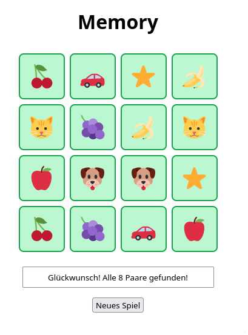
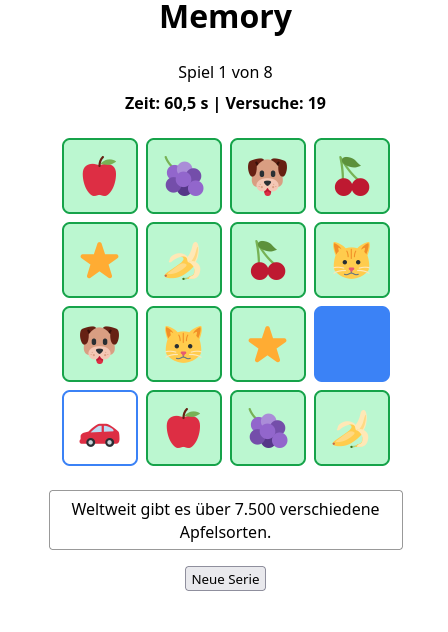
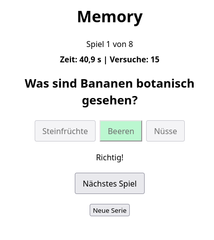
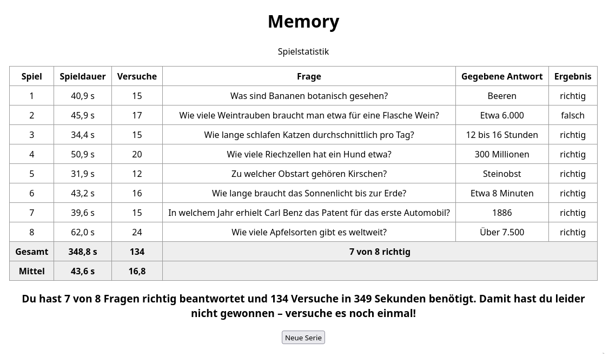
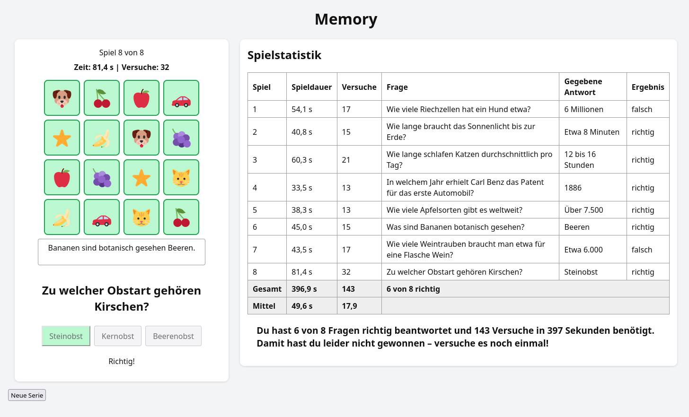

# Memory
Memory Spiel in Javascript

## Memory 1 (index1.html)

Einfaches Memory Spiel.

## Memory 2 - Multi Side (index2.html)

Memory Spiel mit zusätzlichen Texten und einfachen Fragen zu den Texten.
Es wird eine Statistik am Ende des Spiels dargestellt. Das Memory Spiel,
die Fragen und die Statistik werden jeweils auf einer getrennten Seite
dargestellt.

<table><tr><td width=20%>

</td><td width=20%>

</td><td width=50%>

</td></tr></table>

## Memory 3 - Single Side (index3.html)

In der Version 3 werden das Memory Spiel, die Texte, die Fragen und die
Spielstatistik auf einer Seite dargestellt. Die Spielstatistik wird während
des Spiels aktualisiert.

## Plugin für Wordpress

In Arbeit ist ein Plugin für Wordpress, bei dem die Statistik persistent in
Wordpress abgelegt werden soll.

